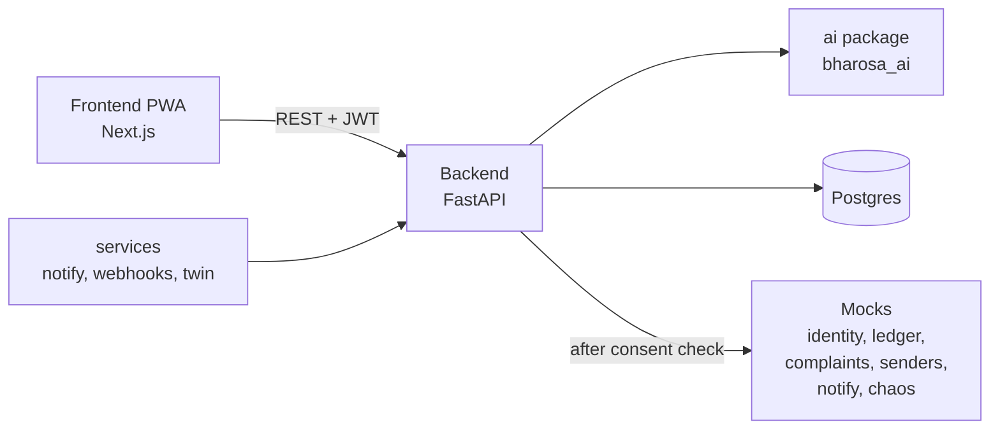

# Bharosa (بھروسہ)

**A trusted assistance layer between citizens and public services. It does not replace government systems.**

> **PROTOTYPE - not an official service. All data is simulated.** The "Sahara Relief Programme" (short code 9090) is fictional. Identity, payment, complaint and SMS services are mocks. CNICs are fake.

Built for **Coder's Cup 2026 AI Hackathon** (ACM NUCES, FAST-NUCES Karachi). Theme: *The Last Mile: AI on Public Rails*. Build window closes Sunday 22 Nov 2026, 6:00 PM PKT.

## The problem
Digital public infrastructure (identity like NADRA, payments like Raast) works for people who can read forms, have signal, and can spot a scam. It fails the last mile for people who cannot: forms are unreadable, signal is weak, one phone is shared by a family or a whole street, and scam SMS messages and middlemen target exactly these users.

**Personas**
- **The widow**: cannot read, weak signal; her relief payment is missing or short.
- **The shopkeeper**: receives fake "relief payment" SMS messages and must tell real from fake.
- **The community helper**: acts for about 40 families on one shared phone.

**Our one task:** *We help low-literacy women on a shared phone get a missing or short-paid relief stipend resolved, even though they can't read forms, have weak signal, and are targeted by scam messages and middlemen.*

## What Bharosa does
- **Check**: paste or share an SMS; get scam / genuine / unsure with confidence and reasons, read aloud in Urdu.
- **Claim**: speak the problem in Urdu and photograph an ID. Bharosa extracts a structured claim, checks the photo, matches the person, checks the ledger, decides (with thresholds and human handoff), and explains in plain language.
- **Control**: see, share, withdraw and correct consent per scope; every action is in the audit log.

## How it meets the brief
| Requirement | Where in code |
|---|---|
| JWT login + server-side RBAC | `backend/app/auth/`, `require_role` in every router |
| Dashboard / role screens | `frontend/src/app/` |
| Case management (create/assign/escalate/close) | `backend/app/routers/cases.py` |
| Public REST API + API keys + Swagger | `backend/app/routers/apikeys.py`, `/docs`, `contracts/openapi-platform.yaml` |
| Audit log of user/AI/agent actions | `backend/app/services/audit.py`, `routers/audit.py` |
| Consent (see/share/withdraw/correct) | `backend/app/services/consent.py`, `routers/consent.py`, `frontend/src/app/citizen/data` |
| Mock identity / payment / data services | `mocks/app/main.py` |
| Postgres + migrations | `backend/migrations/`, `docker-compose.yml` |
| Deployed link, logs, basic tests | See Deployment and Testing below |
| Admin rule editor (versioned rules) | `backend/app/routers/rules.py`, `frontend/src/app/admin/rules` |
| Officer review queue (risk + confidence) | `backend/app/routers/queue.py`, `frontend/src/app/officer` |
| Rate limiting and error handling | `backend/app/` (TODO(Basit)) |
| Low-bandwidth mode, saved progress | `frontend/` (IndexedDB, PWA manifest) |
| Notifications, webhooks | `services/notifications`, `services/webhooks` |
| Helper Mode (bonus) | `backend/app/routers/helper.py`, `frontend/src/app/helper` |
| Digital Twin (bonus, if time) | `services/digital_twin` |
| AI: scam classifier, name matching, OCR + blur, voice->claim, decide, explain, evaluation | `ai/bharosa_ai/`, `ai/eval/` |

Status: the scaffold, contracts, stubs and tests run today; features are filled in by the owners (see each folder's `CLAUDE.md`).

## Architecture

More detail: [docs/architecture.md](docs/architecture.md).

## Decision rule
Combined confidence `>= 0.90` and no red flags -> `auto_handle`; `0.60 to 0.90` -> `ask_more`; below `0.60` or any red flag -> `send_to_human` with case notes. Any payment step always needs officer approval. Errors cost: wrong approval 10, wrong rejection 5, human review 1. See [docs/decision-rule.md](docs/decision-rule.md).

## Real vs simulated
See [docs/real-vs-simulated.md](docs/real-vs-simulated.md). Short version: auth, RBAC, consent, audit, rules, DB and AI code are real; the government services, programme, people, CNICs and SMS are simulated and every mock response says `"simulated": true`.

## Team and ownership
| Person | Folder(s) | Owns |
|---|---|---|
| Ali | `/ai` | Classifier, name matching, OCR, claim extraction, decide, explain, evaluation |
| Basit | `/backend` | FastAPI platform, DB + Alembic, auth/RBAC, cases, claim pipeline, rules, consent, audit, API keys, deploy |
| Hani | `/frontend` | Next.js PWA, all role screens, voice/read-aloud, saved progress, Helper Mode UI |
| Hadi | `/mocks`, `/services`, `/e2e` | Mock services, synthetic data, Chaos Panel backend, notifications, webhooks, Digital Twin, e2e tests, demo |
| Everyone | `/contracts`, `/docs` | Shared contracts; additive changes only, announced to the team |

## Quick start
**Prerequisites:** Python 3.9+ (3.11 in Docker), Node 20+, Docker (optional).

```bash
cp .env.example .env            # fake values, safe for local use

# Option A: everything in Docker (postgres + backend + mocks)
docker compose up --build       # backend :8000 (Swagger /docs), mocks :8001 (/docs)

# Option B: local Python
make install                    # creates .venv
make dev                        # mocks :8001 + backend :8000

# Frontend (separate)
cd frontend
npm install
npm run sync-contracts
npm run dev                     # http://localhost:3000, fixtures mode by default
```

**Demo logins** (username = role; fake passwords from `.env.example`):

| Role | Username | Password |
|---|---|---|
| citizen | `citizen` | `citizen-demo-123` |
| helper | `helper` | `helper-demo-123` |
| officer | `officer` | `officer-demo-123` |
| admin | `admin` | `admin-demo-123` |
| auditor | `auditor` | `auditor-demo-123` |

## Environment flags
| Flag | Values | Meaning |
|---|---|---|
| `AI_MODE` | `stub` / `real` | Fixed stub outputs vs real AI implementations |
| `MOCKS_URL` | URL / empty | Where the backend finds mock services (empty -> in-process fake client) |
| `NEXT_PUBLIC_API_MODE` | `fixtures` / `live` | Frontend uses contract fixtures vs the live backend |
| `DATABASE_URL` | Postgres URL | Backend database |
| `JWT_SECRET` | string | JWT signing secret (change in production) |
| `LLM_API_KEY` | string | Needed only for `AI_MODE=real` |

## Testing
```bash
make test                       # ai, backend, mocks
make lint                       # ruff
cd frontend && npm run lint && npm run build
```
End-to-end scenarios (TODO(Hadi)) are listed in [e2e/README.md](e2e/README.md).

## Deployment
- Backend: Render or Railway (build with `backend/Dockerfile` from repo root).
- Frontend: Vercel (root `frontend`, `NEXT_PUBLIC_API_MODE=live`, `NEXT_PUBLIC_API_URL=<backend>`).
- Database: Supabase Postgres (`DATABASE_URL`).

| Item | Link |
|---|---|
| Frontend (deployed) | _TODO: add URL_ |
| Backend / Swagger | _TODO: add URL_ |
| Demo video | _TODO: add URL_ |

## Known limitations
_To be filled in honestly as we build._ Currently: backend routers return fixtures; AI runs in `stub` mode; no real database persistence yet; demo users are in memory.

## Docs
[Architecture](docs/architecture.md) · [Decision rule](docs/decision-rule.md) · [Real vs simulated](docs/real-vs-simulated.md) · [Demo script](docs/demo-script.md) · [Judge checklist](docs/judge-checklist.md)
