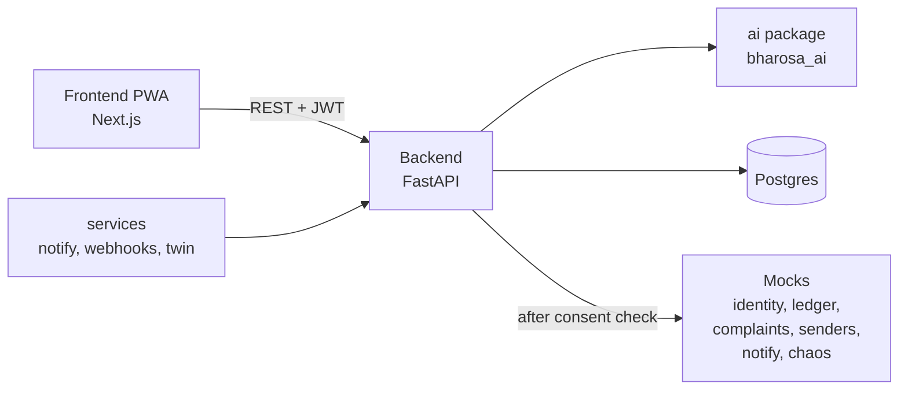

# Bharosa (بھروسہ)

**A trusted assistance layer between citizens and public services. It does not replace government systems.**

> **PROTOTYPE - not an official service. All data is simulated.** The "Sahara Relief Programme" (short code 9090) is fictional. Identity, payment, complaint and SMS services are mocks. CNICs are fake.

Built for **Coder's Cup 2026 AI Hackathon** (ACM NUCES, FAST-NUCES Karachi). Theme: *The Last Mile: AI on Public Rails*. Build window closes Sunday 22 Nov 2026, 6:00 PM PKT.

## The problem
Digital public infrastructure (identity like NADRA, payments like Raast) works for people who can read forms, have signal, and can spot a scam. It fails the last mile for people who cannot: forms are unreadable, signal is weak, one phone is shared by a family or a whole street, and scam SMS messages and middlemen target exactly these users.

**Personas**
- **The widow**: cannot read, weak signal; her relief payment is missing or short.
- **The shopkeeper**: receives fake "relief payment" SMS messages and must tell real from fake.
- **The community helper**: acts for about 40 families on one shared phone.

**Our one task:** *We help low-literacy women on a shared phone get a missing or short-paid relief stipend resolved, even though they can't read forms, have weak signal, and are targeted by scam messages and middlemen.*

## What Bharosa does
- **Check**: paste or share an SMS; get scam / genuine / unsure with confidence and reasons, read aloud in Urdu.
- **Claim**: speak the problem in Urdu and photograph an ID. Bharosa extracts a structured claim, checks the photo, matches the person, checks the ledger, decides (with thresholds and human handoff), and explains in plain language.
- **Control**: see, share, withdraw and correct consent per scope; every action is in the audit log.

## How it meets the brief
| Requirement | Where in code |
|---|---|
| JWT login + server-side RBAC | `backend/app/auth/`, `require_role` in every router |
| Dashboard / role screens | `frontend/src/app/` |
| Case management (create/assign/escalate/close) | `backend/app/routers/cases.py` |
| Public REST API + API keys + Swagger | `backend/app/routers/apikeys.py`, `/docs`, `contracts/openapi-platform.yaml` |
| Audit log of user/AI/agent actions | `backend/app/services/audit.py`, `routers/audit.py` |
| Consent (see/share/withdraw/correct) | `backend/app/services/consent.py`, `routers/consent.py`, `frontend/src/app/citizen/data` |
| Mock identity / payment / data services | `mocks/app/main.py` |
| Postgres + migrations | `backend/migrations/`, `docker-compose.yml` |
| Deployed link, logs, basic tests | See Deployment and Testing below |
| Admin rule editor (versioned rules) | `backend/app/routers/rules.py`, `frontend/src/app/admin/rules` |
| Officer review queue (risk + confidence) | `backend/app/routers/queue.py`, `frontend/src/app/officer` |
| Rate limiting and error handling | `backend/app/` (TODO(Basit)) |
| Low-bandwidth mode, saved progress | `frontend/` (IndexedDB, PWA manifest) |
| Notifications, webhooks | `services/notifications`, `services/webhooks` |
| Helper Mode (bonus) | `backend/app/routers/helper.py`, `frontend/src/app/helper` |
| Digital Twin (bonus, if time) | `services/digital_twin` |
| AI: scam classifier, name matching, OCR + blur, voice->claim, decide, explain, evaluation | `ai/bharosa_ai/`, `ai/eval/` |

Status: the scaffold, contracts, stubs and tests run today; features are filled in by the owners (see each folder's `CLAUDE.md`).

## Architecture

More detail: [docs/architecture.md](docs/architecture.md).

## Decision rule
Combined confidence `>= 0.90` and no red flags -> `auto_handle`; `0.60 to 0.90` -> `ask_more`; below `0.60` or any red flag -> `send_to_human` with case notes. Any payment step always needs officer approval. Errors cost: wrong approval 10, wrong rejection 5, human review 1. See [docs/decision-rule.md](docs/decision-rule.md).

## Real vs simulated
See [docs/real-vs-simulated.md](docs/real-vs-simulated.md). Short version: auth, RBAC, consent, audit, rules, DB and AI code are real; the government services, programme, people, CNICs and SMS are simulated and every mock response says `"simulated": true`.

## Team and ownership
| Person | Folder(s) | Owns |
|---|---|---|
| Ali | `/ai` | Classifier, name matching, OCR, claim extraction, decide, explain, evaluation |
| Basit | `/backend` | FastAPI platform, DB + Alembic, auth/RBAC, cases, claim pipeline, rules, consent, audit, API keys, deploy |
| Hani | `/frontend` | Next.js PWA, all role screens, voice/read-aloud, saved progress, Helper Mode UI |
| Hadi | `/mocks`, `/services`, `/e2e` | Mock services, synthetic data, Chaos Panel backend, notifications, webhooks, Digital Twin, e2e tests, demo |
| Everyone | `/contracts`, `/docs` | Shared contracts; additive changes only, announced to the team |

## Quick start
**Prerequisites:** Python 3.9+ (3.11 in Docker), Node 20+, Docker (optional).

```bash
cp .env.example .env            # fake values, safe for local use

# Option A: everything in Docker (postgres + backend + mocks)
docker compose up --build       # backend :8000 (Swagger /docs), mocks :8001 (/docs)

# Option B: local Python
make install                    # creates .venv
make dev                        # mocks :8001 + backend :8000

# Frontend (separate)
cd frontend
npm install
npm run sync-contracts
npm run dev                     # http://localhost:3000, fixtures mode by default
```

**Demo logins** (username = role; fake passwords from `.env.example`):

| Role | Username | Password |
|---|---|---|
| citizen | `citizen` | `citizen-demo-123` |
| helper | `helper` | `helper-demo-123` |
| officer | `officer` | `officer-demo-123` |
| admin | `admin` | `admin-demo-123` |
| auditor | `auditor` | `auditor-demo-123` |

## Backend: what it guarantees, and how to see each one in under a minute
Start it: `docker compose up --build` (API + Swagger at http://localhost:8000/docs). Helper for the commands below:
```bash
API=http://localhost:8000
tok() { curl -s $API/auth/login -H 'content-type: application/json' -d "{\"username\":\"$1\",\"password\":\"$2\"}" | python3 -c 'import sys,json;print(json.load(sys.stdin)["access_token"])'; }
CIT=$(tok citizen citizen-demo-123); OFF=$(tok officer officer-demo-123); ADM=$(tok admin admin-demo-123); AUD=$(tok auditor auditor-demo-123)
```

| Guarantee | What it means | See it (about 30 seconds) |
|---|---|---|
| **RBAC enforced on the server** | Roles come from the database on every request; ids of other people answer 404; auditors are read-only everywhere. A test walks **every route** to prove it. | `curl -s -o /dev/null -w "%{http_code}\n" $API/queue -H "Authorization: Bearer $CIT"` -> **403** · `curl -s -o /dev/null -w "%{http_code}\n" $API/cases/case-0001 -H "Authorization: Bearer $CIT"` -> **404** (not hers) · `curl -s -o /dev/null -w "%{http_code}\n" -X POST $API/cases -H "Authorization: Bearer $AUD" -H 'content-type: application/json' -d '{"claim_type":"missing","amount_claimed_pkr":1}'` -> **403** |
| **Append-only audit, enforced in the database** | Every user, AI and agent action is logged. A Postgres trigger refuses UPDATE, DELETE and TRUNCATE on `audit_log`, even for the app itself. | `curl -s "$API/audit?limit=3" -H "Authorization: Bearer $AUD"` · `docker compose exec postgres psql -U bharosa -c "update audit_log set action='x'"` -> **ERROR: audit_log is append-only** |
| **Consent before every external call** | Identity, payment and notification lookups first check consent. A withdrawn consent stops the step and the attempt is logged. | Demo scenario 5: `make demo-scenarios` (or see [docs/demo-scenarios.md](docs/demo-scenarios.md)) then `curl -s "$API/audit?action=consent.blocked" -H "Authorization: Bearer $ADM"` |
| **Idempotent payments** | A payment key `case_id:decision_id` is stored before the money call, so a retry or a double click can never pay twice. | `for i in 1 2; do curl -s -o /dev/null -w "%{http_code} " -X POST $API/cases/case-0001/decide -H "Authorization: Bearer $OFF" -H 'content-type: application/json' -d '{"action":"approve","reason":"Ledger shows 8000 of 12000"}'; done` -> **200 409** · `curl -s "$API/audit?action=payment.release" -H "Authorization: Bearer $ADM"` shows **one** payment |
| **Failures go to an officer, never to an error page** | A slow or broken service, missing consent or a bug pauses the claim, adds a note and returns normally; `resume` continues where it stopped. | Demo scenario 6 (identity service down): `curl -s -X POST $API/admin/demo/chaos -H "Authorization: Bearer $ADM" -H 'content-type: application/json' -d '{"identity_down":true}'`, file a claim as `s6-idown`, see `with_officer` + note |
| **Rules are versioned and live** | An admin publishes a new, validated rule version: active at once, no restart; old decisions keep their version; unsafe rules are refused; a what-if shows the impact first. | `curl -s -X POST $API/rules/rule-stipend-short-payment/simulate -H "Authorization: Bearer $ADM" -H 'content-type: application/json' -d '{"auto_handle_min":0.99,"ask_more_min":0.6}'` · `curl -s -X POST $API/rules/rule-stipend-short-payment/versions -H "Authorization: Bearer $ADM" -H 'content-type: application/json' -d '{"auto_handle_min":0.5,"ask_more_min":0.3,"logic":{"if":[true,"auto_handle","auto_handle"]}}'` -> **422 Unsafe rule** |

More: **everything at once** with `make demo-scenarios` (resets, runs the six scenarios over HTTP, prints each outcome; run the backend with `BACKEND_MOCKS_URL= docker compose up`). **Reset** to a known state any time: `make demo-reset` or `POST /admin/demo/reset`. **Weak internet**: claims return `202` immediately and run in the background (`GET /claims/{id}/progress`, ETag/304), responses are gzip and compact, ID photos are resized and stored in the database. **Privacy**: `GET /scam-map` returns counts only; areas with fewer than 3 reports are shown as `other`. Details: [docs/demo-scenarios.md](docs/demo-scenarios.md) · [backend/CLAUDE.md](backend/CLAUDE.md).

### Demo logins (all fake)
| Who | Username | Password | Use it for |
|---|---|---|---|
| Citizen | `citizen` | `citizen-demo-123` | scam check, claim, consent, "someone else's case is 404" |
| Helper | `helper` | `helper-demo-123` | files for 16 linked citizens (needs the citizen's PIN `1234` to grant consent for them) |
| Officer | `officer` | `officer-demo-123` | review queue, decisions (reason required), payments |
| Admin | `admin` | `admin-demo-123` | rules, simulation, API keys, demo reset and outage switches |
| Auditor | `auditor` | `auditor-demo-123` | read-only: audit log, cases, scam map, evaluation |
| Demo scenario 1-6 | `s1-clean`, `s2-spelling`, `s3-shortpay`, `s4-duplicate`, `s5-consent`, `s6-idown` | `citizen-demo-123` | the six scenarios above |

## Frontend screens
Next.js PWA in `frontend/` (mobile-first, Urdu + English, read-aloud, saved progress). Runs without a backend in `fixtures` mode.

| Route | Who | What |
|---|---|---|
| `/` | everyone | Landing: pitch, problem, Check / Claim / Control cards, prototype notice |
| `/login` | everyone | Demo users (fake) or username + password |
| `/citizen`, `/citizen/check`, `/citizen/claim`, `/citizen/status`, `/citizen/data` | citizen, helper | Home, scam check, voice + photo claim, claim timeline, consent (stub) |
| `/helper`, `/helper/[familyId]` | helper | Family list; one person's case with "switch person" |
| `/officer`, `/officer/case/[id]` | officer | Review queue; case detail with confidence, reasons, rule version, trace, decision buttons |
| `/admin`, `/admin/rules`, `/admin/twin`, `/admin/chaos` | admin | Users and roles; rule editor (stub); Digital Twin; Chaos Panel (stub) |
| `/auditor`, `/eval` | auditor / officer, admin | Audit log (stub); evaluation (stub) |

Components: `PrototypeBanner`, `PageShell`, `RoleGuard`, `BigIconButton`, `MicButton`, `ReadAloud`, `PhotoCapture`, `StatusTimeline`. Progress is saved per person in IndexedDB (`src/lib/offline.ts`). Details: [frontend/CLAUDE.md](frontend/CLAUDE.md).

## Environment flags
| Flag | Values | Meaning |
|---|---|---|
| `AI_MODE` | `stub` / `real` | Fixed stub outputs vs real AI implementations |
| `MOCKS_URL` | URL / empty | Where the backend finds mock services (empty -> in-process fake client) |
| `NEXT_PUBLIC_API_MODE` | `fixtures` / `live` | Frontend uses contract fixtures vs the live backend |
| `DATABASE_URL` | Postgres URL | Backend database |
| `JWT_SECRET` | string | JWT signing secret (change in production) |
| `LLM_API_KEY` | string | Needed only for `AI_MODE=real` |

## Testing
```bash
make test                       # ai, backend, mocks
make lint                       # ruff
cd frontend && npm run lint && npm run build
```
End-to-end scenarios (TODO(Hadi)) are listed in [e2e/README.md](e2e/README.md).

## Deployment
- Backend: Render or Railway (build with `backend/Dockerfile` from repo root).
- Frontend: Vercel (root `frontend`, `NEXT_PUBLIC_API_MODE=live`, `NEXT_PUBLIC_API_URL=<backend>`).
- Database: Supabase Postgres (`DATABASE_URL`).

| Item | Link |
|---|---|
| Frontend (deployed) | _TODO: add URL_ |
| Backend / Swagger | _TODO: add URL_ |
| Demo video | _TODO: add URL_ |

## Known limitations
_To be filled in honestly as we build._ Currently: the backend is database-backed end to end (claim agent in the background, public API keys, rate limiting, `/eval`), but AI runs in `stub` mode (the stub claim extractor always hears the name "Mohammad Aslam" with confidence 0.81, so most demo claims end in `needs_more_proof` or the officer queue); the mock `/payments/disburse` does not exist yet (the backend falls back to a `/complaints` ticket); ID photos are stored on local disk; webhooks are not delivered yet; nothing is deployed.

## Docs
[Architecture](docs/architecture.md) · [Decision rule](docs/decision-rule.md) · [Real vs simulated](docs/real-vs-simulated.md) · [Demo script](docs/demo-script.md) · [Judge checklist](docs/judge-checklist.md)
