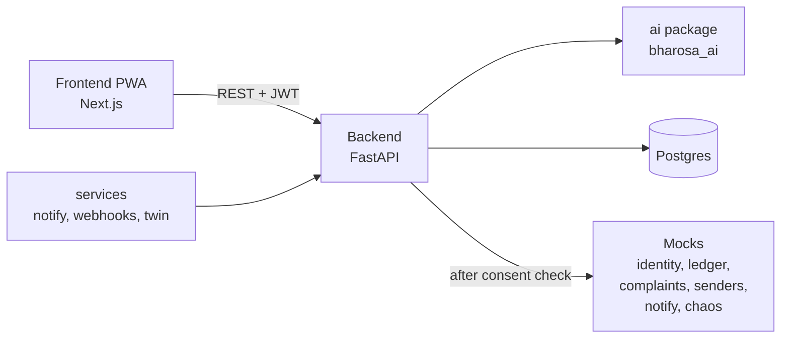

# Bharosa (بھروسہ)

**A trusted assistance layer between citizens and public services. It does not replace government systems.**

> **PROTOTYPE - not an official service. All data is simulated.** The "Sahara Relief Programme" (short code 9090) is fictional. Identity, payment, complaint and SMS services are mocks. CNICs are fake.

Built for **Coder's Cup 2026 AI Hackathon** (ACM NUCES, FAST-NUCES Karachi). Theme: *The Last Mile: AI on Public Rails*. Build window closes Sunday 22 Nov 2026, 6:00 PM PKT.

## The problem
Digital public infrastructure (identity like NADRA, payments like Raast) works for people who can read forms, have signal, and can spot a scam. It fails the last mile for people who cannot: forms are unreadable, signal is weak, one phone is shared by a family or a whole street, and scam SMS messages and middlemen target exactly these users.

**Personas**
- **The widow**: cannot read, weak signal; her relief payment is missing or short.
- **The shopkeeper**: receives fake "relief payment" SMS messages and must tell real from fake.
- **The community helper**: acts for about 40 families on one shared phone.

**Our one task:** *We help low-literacy women on a shared phone get a missing or short-paid relief stipend resolved, even though they can't read forms, have weak signal, and are targeted by scam messages and middlemen.*

## What Bharosa does
- **Check**: paste or share an SMS; get scam / genuine / unsure with confidence and reasons, read aloud in Urdu.
- **Claim**: speak the problem in Urdu and photograph an ID. Bharosa extracts a structured claim, checks the photo, matches the person, checks the ledger, decides (with thresholds and human handoff), and explains in plain language.
- **Control**: see, share, withdraw and correct consent per scope; every action is in the audit log.

## How it meets the brief
| Requirement | Where in code |
|---|---|
| JWT login + server-side RBAC | `backend/app/auth/`, `require_role` in every router |
| Dashboard / role screens | `frontend/src/app/` |
| Case management (create/assign/escalate/close) | `backend/app/routers/cases.py` |
| Public REST API + API keys + Swagger | `backend/app/routers/apikeys.py`, `/docs`, `contracts/openapi-platform.yaml` |
| Audit log of user/AI/agent actions | `backend/app/services/audit.py`, `routers/audit.py` |
| Consent (see/share/withdraw/correct) | `backend/app/services/consent.py`, `routers/consent.py`, `frontend/src/app/citizen/data` |
| Mock identity / payment / data services | `mocks/app/main.py` |
| Postgres + migrations | `backend/migrations/`, `docker-compose.yml` |
| Deployed link, logs, basic tests | See Deployment and Testing below |
| Admin rule editor (versioned rules) | `backend/app/routers/rules.py`, `frontend/src/app/admin/rules` |
| Officer review queue (risk + confidence) | `backend/app/routers/queue.py`, `frontend/src/app/officer` |
| Rate limiting and error handling | `backend/app/` (TODO(Basit)) |
| Low-bandwidth mode, saved progress | `frontend/` (IndexedDB, PWA manifest) |
| Notifications, webhooks | `services/notifications`, `services/webhooks` |
| Helper Mode (bonus) | `backend/app/routers/helper.py`, `frontend/src/app/helper` |
| Digital Twin (bonus, if time) | `services/digital_twin` |
| AI: scam classifier, name matching, OCR + blur, voice->claim, decide, explain, evaluation | `ai/bharosa_ai/`, `ai/eval/` |

Status: **integrated**. AI, backend, mocks, services and the frontend are merged and run together (see Quick start). Every claim above is exercised by the tests, the 7 demo scenarios and the browser walkthrough in `docs/screenshots/`.

## Architecture

More detail: [docs/architecture.md](docs/architecture.md).

## Decision rule
Combined confidence `>= 0.90` and no red flags -> `auto_handle`; `0.60 to 0.90` -> `ask_more`; below `0.60` or any red flag -> `send_to_human` with case notes. Any payment step always needs officer approval. Errors cost: wrong approval 10, wrong rejection 5, human review 1. See [docs/decision-rule.md](docs/decision-rule.md).

## Real vs simulated
| Real code, enforced on the server | Simulated or fake |
|---|---|
| JWT login, RBAC on every route, row-level access | The "Sahara Relief Programme", code `9090`, all people, CNICs (`00000...`) |
| Append-only audit log (also a Postgres trigger) | Identity (NADRA-like) and ledger (Raast-like) services: `/mocks` |
| Consent checked before every external call | Payments: no money moves; the **idempotency + officer-approval logic is real** |
| Versioned rules, validation, what-if simulation | SMS / notifications, complaints, webhooks delivery targets |
| Claim agent: background jobs, saved steps, resume | ID photos and voice are synthetic test data |
| Scam classifier, name matching, decision, explanation | Training / evaluation data (synthetic) |
| Public API keys, rate limits, error format | Demo accounts and the 7 scenario citizens |

Every mock response carries `"simulated": true`; every page shows the "PROTOTYPE - simulated data" banner. Full list: [docs/real-vs-simulated.md](docs/real-vs-simulated.md).

## Team and ownership
| Person | Folder(s) | Owns |
|---|---|---|
| Ali | `/ai` | Classifier, name matching, OCR, claim extraction, decide, explain, evaluation |
| Basit | `/backend` | FastAPI platform, DB + Alembic, auth/RBAC, cases, claim pipeline, rules, consent, audit, API keys, deploy |
| Hani | `/frontend` | Next.js PWA, all role screens, voice/read-aloud, saved progress, Helper Mode UI |
| Hadi | `/mocks`, `/services`, `/e2e` | Mock services, synthetic data, Chaos Panel backend, notifications, webhooks, Digital Twin, e2e tests, demo |
| Everyone | `/contracts`, `/docs` | Shared contracts; additive changes only, announced to the team |

## Quick start (the whole merged system)
**Prerequisites:** Python 3.9+ (3.11 in Docker), Node 20+, Docker.

```bash
cp .env.example .env                     # fake values, safe for local use

# 1. backend + real mocks + Postgres (seeds fake demo data on start)
docker compose up --build                # backend :8000 (Swagger /docs), mocks :8001 (/docs), services :8002, postgres
#    port 5432 busy?   POSTGRES_PORT=55432 docker compose up --build
#    real AI (offline, works without an LLM key): AI_MODE=real docker compose up --build

# 2. frontend in live mode (CORS allows http://localhost:3000)
cd frontend && npm install && npm run sync-contracts
NEXT_PUBLIC_API_MODE=live NEXT_PUBLIC_API_URL=http://localhost:8000 npm run build && npm run start -- -p 3000
#    without a backend: npm run dev   (fixtures mode, nothing else needed)

# 3. prove it works
make install && make test                # ai + backend + mocks + services
make demo-scenarios                      # the 8 scenarios over HTTP against the running stack
PYTHONPATH=.:e2e .venv/bin/python -m pytest e2e -v    # Hadi's end-to-end scenarios (needs the stack, plus services on :8002)
```
Local without Docker: `make install && make dev` (mocks :8001 + backend :8000 with SQLite/Postgres per `.env`).
Services (notifications, webhooks) run in the compose file; locally: `WEBHOOKS_ALLOW_LOCAL=1 PYTHONPATH=. .venv/bin/python -m uvicorn services.main:app --port 8002`, then start the backend with `NOTIFICATIONS_URL=http://localhost:8002 WEBHOOKS_URL=http://localhost:8002`.

**Demo logins** (username = role; fake passwords from `.env.example`):

| Role | Username | Password |
|---|---|---|
| citizen | `citizen` | `citizen-demo-123` |
| helper | `helper` | `helper-demo-123` |
| officer | `officer` | `officer-demo-123` |
| admin | `admin` | `admin-demo-123` |
| auditor | `auditor` | `auditor-demo-123` |

## Backend: what it guarantees, and how to see each one in under a minute
Start it: `docker compose up --build` (API + Swagger at http://localhost:8000/docs). Helper for the commands below:
```bash
API=http://localhost:8000
tok() { curl -s $API/auth/login -H 'content-type: application/json' -d "{\"username\":\"$1\",\"password\":\"$2\"}" | python3 -c 'import sys,json;print(json.load(sys.stdin)["access_token"])'; }
CIT=$(tok citizen citizen-demo-123); OFF=$(tok officer officer-demo-123); ADM=$(tok admin admin-demo-123); AUD=$(tok auditor auditor-demo-123)
```

| Guarantee | What it means | See it (about 30 seconds) |
|---|---|---|
| **RBAC enforced on the server** | Roles come from the database on every request; ids of other people answer 404; auditors are read-only everywhere. A test walks **every route** to prove it. | `curl -s -o /dev/null -w "%{http_code}\n" $API/queue -H "Authorization: Bearer $CIT"` -> **403** · `curl -s -o /dev/null -w "%{http_code}\n" $API/cases/case-0001 -H "Authorization: Bearer $CIT"` -> **404** (not hers) · `curl -s -o /dev/null -w "%{http_code}\n" -X POST $API/cases -H "Authorization: Bearer $AUD" -H 'content-type: application/json' -d '{"claim_type":"missing","amount_claimed_pkr":1}'` -> **403** |
| **Append-only audit, enforced in the database** | Every user, AI and agent action is logged. A Postgres trigger refuses UPDATE, DELETE and TRUNCATE on `audit_log`, even for the app itself. | `curl -s "$API/audit?limit=3" -H "Authorization: Bearer $AUD"` · `docker compose exec postgres psql -U bharosa -c "update audit_log set action='x'"` -> **ERROR: audit_log is append-only** |
| **Consent before every external call** | Identity, payment and notification lookups first check consent. A withdrawn consent stops the step and the attempt is logged. | Demo scenario 5: `make demo-scenarios` (or see [docs/demo-scenarios.md](docs/demo-scenarios.md)) then `curl -s "$API/audit?action=consent.blocked" -H "Authorization: Bearer $ADM"` |
| **Idempotent payments** | A payment key `case_id:decision_id` is stored before the money call, so a retry or a double click can never pay twice. | `for i in 1 2; do curl -s -o /dev/null -w "%{http_code} " -X POST $API/cases/case-0001/decide -H "Authorization: Bearer $OFF" -H 'content-type: application/json' -d '{"action":"approve","reason":"Ledger shows 8000 of 12000"}'; done` -> **200 409** · `curl -s "$API/audit?action=payment.release" -H "Authorization: Bearer $ADM"` shows **one** payment |
| **Failures go to an officer, never to an error page** | A slow or broken service, missing consent or a bug pauses the claim, adds a note and returns normally; `resume` continues where it stopped. | Demo scenario 6 (identity service down): `curl -s -X POST $API/admin/demo/chaos -H "Authorization: Bearer $ADM" -H 'content-type: application/json' -d '{"identity_down":true}'`, file a claim as `s6-idown`, see `with_officer` + note |
| **Rules are versioned and live** | An admin publishes a new, validated rule version: active at once, no restart; old decisions keep their version; unsafe rules are refused; a what-if shows the impact first. | `curl -s -X POST $API/rules/rule-stipend-short-payment/simulate -H "Authorization: Bearer $ADM" -H 'content-type: application/json' -d '{"auto_handle_min":0.99,"ask_more_min":0.6}'` · `curl -s -X POST $API/rules/rule-stipend-short-payment/versions -H "Authorization: Bearer $ADM" -H 'content-type: application/json' -d '{"auto_handle_min":0.5,"ask_more_min":0.3,"logic":{"if":[true,"auto_handle","auto_handle"]}}'` -> **422 Unsafe rule** |

More: **everything at once** with `make demo-scenarios` (resets, runs the eight scenarios over HTTP, prints each outcome; works with the real mocks and with the built-in fake ones; login is limited to `LOGIN_RATE_LIMIT`: unset = 30/minute while `DEMO_MODE=1`, 5/minute otherwise). **Reset** to a known state any time: `make demo-reset` or `POST /admin/demo/reset`. **Weak internet**: claims return `202` immediately and run in the background (`GET /claims/{id}/progress`, ETag/304), responses are gzip and compact, ID photos are resized and stored in the database. **Privacy**: `GET /scam-map` returns counts only; areas with fewer than 3 reports are shown as `other`. Details: [docs/demo-scenarios.md](docs/demo-scenarios.md) · [backend/CLAUDE.md](backend/CLAUDE.md).

### Demo logins (all fake)
| Who | Username | Password | Use it for |
|---|---|---|---|
| Citizen | `citizen` | `citizen-demo-123` | scam check, claim, consent, "someone else's case is 404" |
| Helper | `helper` | `helper-demo-123` | files for 17 linked citizens (needs the citizen's PIN `1234` to grant consent for them) |
| Officer | `officer` | `officer-demo-123` | review queue, decisions (reason required), payments |
| Admin | `admin` | `admin-demo-123` | rules, simulation, API keys, demo reset and outage switches |
| Auditor | `auditor` | `auditor-demo-123` | read-only: audit log, cases, scam map, evaluation |
| **Live demo citizen** | `demo-live` (Samina Parveen, PIN `1234`) | `citizen-demo-123` | **use this one in front of judges**: no open October claim, so a live claim never hits the duplicate rule (ends `needs_more_proof`) |
| Demo scenario 1-7 | `s1-clean`, `s2-spelling`, `s3-shortpay`, `s4-duplicate`, `s5-consent`, `s6-idown`, `s7-autohandle` | `citizen-demo-123` | the scenarios (4 = the duplicate demo, 7 = auto-handled payment check) |

## Frontend screens
Next.js PWA in `frontend/` (mobile-first, Urdu + English, read-aloud, saved progress, data-saver mode, service worker). Runs without a backend in `fixtures` mode and against the real API in `live` mode. Screenshots of every step: [docs/screenshots/](docs/screenshots/).

| Route | Who | What |
|---|---|---|
| `/` | everyone | Landing: pitch, problem, Check / Claim / Control cards, prototype notice |
| `/login` | everyone | Demo users (fake) or username + password |
| `/citizen`, `/citizen/check`, `/citizen/claim`, `/citizen/status`, `/citizen/data` | citizen, helper | Home + "Did my payment arrive?", scam check, voice + photo claim (202, live progress, **Try again** after a pause), claim timeline, consent (see / withdraw / share / correct) |
| `/helper`, `/helper/[familyId]` | helper | Family list; one person's case, PIN consent grant, "switch person" |
| `/officer`, `/officer/case/[id]` | officer | Review queue; case detail with confidence, reasons, rule version, trace, **ID photo**, decision buttons |
| `/admin`, `/admin/rules`, `/admin/twin`, `/admin/chaos` | admin | Users, API keys; rule editor + publish; Digital Twin (real `/rules/{id}/simulate`); Chaos Panel (drives the real mocks) |
| `/auditor`, `/eval` | auditor / officer, admin | Audit log with filters and diffs; evaluation numbers + Scam Map |

Details: [frontend/CLAUDE.md](frontend/CLAUDE.md).

## Environment flags
| Flag | Values | Meaning |
|---|---|---|
| `AI_MODE` | `stub` / `real` | Fixed stub outputs vs real AI implementations |
| `MOCKS_URL` | URL / empty | Where the backend finds mock services (empty -> in-process fake client) |
| `NEXT_PUBLIC_API_MODE` | `fixtures` / `live` | Frontend uses contract fixtures vs the live backend |
| `DATABASE_URL` | Postgres URL | Backend database |
| `JWT_SECRET` | string | JWT signing secret (change in production) |
| `LLM_API_KEY` | string | Optional. `AI_MODE=real` runs fully offline without it; with a key the LLM only helps claim extraction and explanations |
| `AI_DEFAULT_PERIOD` | `YYYY-MM` | What "this month" means in claim speech. The demo data is for `2026-10` (compose default) |
| `CORS_ORIGINS` | comma list | Browser origins the backend accepts (default `http://localhost:3000`) |

## Testing
```bash
make test                       # ai, backend, mocks, services
make test-integration           # AI_MODE=real: the pipeline with the real AI functions (4 tests)
make lint                       # ruff
make demo-scenarios             # the 8 scenarios over HTTP (fake or real mocks; stub or real AI)
cd frontend && npm run lint && npm run build
PYTHONPATH=.:e2e .venv/bin/python -m pytest e2e -v    # end-to-end, needs the running stack
```
Last run (branch `final-fixes`): ai 661 passed / 10 skipped (stub) and 658 / 13 (`AI_MODE=real`), backend 471, mocks 48, services 31, integration 4, e2e 13 of 13 with stub AI **and** with `AI_MODE=real` without a key, 8/8 scenarios both ways, frontend lint + build clean, 25/25 browser walkthrough steps (mobile viewport, live mode). Scenario outcomes: [docs/demo-scenarios.md](docs/demo-scenarios.md). Browser walkthrough: `e2e/ui/walkthrough.mjs`, screenshots in `docs/screenshots/`.

## The 8 demo scenarios
`make demo-scenarios` resets and runs all eight. Each one reaches a different outcome (login `s1-clean` ... `s7-autohandle` and `demo-live`, password `citizen-demo-123`). Same outcomes with the stub AI and with `AI_MODE=real` (confidences differ).

| # | Scenario | Outcome |
|---|---|---|
| 1 | Clean approval | `needs_more_proof`, officer approves, PKR 12000 paid once (second approve = 409) |
| 2 | Misspelled name | name matched as a spelling variant, `needs_more_proof` |
| 3 | Short payment by `agent-099` | `with_officer`, flag `short_payment`, PKR 4000 top-up |
| 4 | Duplicate claim, same month | `with_officer`, flag `duplicate_claim` |
| 5 | Consent withdrawn | ledger step blocked and logged, grant again + resume completes |
| 6 | Identity service down | paused at `identity_lookup` with a note, service back + resume completes |
| 7 | Payment check, nothing owed | AI `auto_handle` (0.95 stub / 0.97 real), case `closed`, no payment, no officer |
| 8 | **Live demo citizen** (`demo-live`) | full pipeline, no duplicate flag, `needs_more_proof` (PKR 12000 shortfall for the officer) |

## Evaluation (synthetic data, `python ai/eval/run_eval.py`, offline)
| Part | Result |
|---|---|
| Scam classifier (n=150) | accuracy 0.953, precision(scam) 1.000, recall(scam) 0.892, dangerous errors 0 |
| Name matching (n=48) | top-1 0.938, false match 0.042, miss 0.021 |
| Claim extraction (n=25) | understood 1.00, invented claims 0, refusals correct 1.00 |
| ID photo check (n=38) | good photos accepted 1.00, bad photos sent for retake 1.00 |
| Decision (n=1000) | wrong approvals 0, wrong rejections 28, human reviews 411, cost 551 |
| Auto-handle threshold | 0.90 is the cheapest of the tested thresholds (cost 950 per 1000 cases) |
Numbers are an upper bound: the data is synthetic. Live numbers from real use are at `GET /eval` and the `/eval` page.

## Deployment
- Backend: Render or Railway (build with `backend/Dockerfile` from repo root).
- Frontend: Vercel (root `frontend`, `NEXT_PUBLIC_API_MODE=live`, `NEXT_PUBLIC_API_URL=<backend>`).
- Database: Supabase Postgres (`DATABASE_URL`).

| Item | Link |
|---|---|
| Frontend (deployed) | _TODO: add URL_ (Hani, Vercel) |
| Backend / Swagger | _TODO: add URL_ (Basit, Render + Supabase) |
| Demo video | _TODO: add URL_ |

## How to enable the LLM
It is optional and needs **no code change**: set `LLM_API_KEY`, `LLM_MODEL` and **`LLM_BASE_URL` for your provider** in the backend environment and **restart**. Tested with Gemini: `LLM_BASE_URL=https://generativelanguage.googleapis.com/v1beta/openai`, `LLM_MODEL=gemini-2.5-flash` (about 1 s per call; the app waits 8 s, so slower "thinking" models time out). Blank `LLM_BASE_URL` means xAI, and a key sent to the wrong provider is exposed to it. On a rate limit (429) the client retries with a pause, then skips the LLM for 20 s and the offline parser answers. `GET /health` then shows `extract_claim: real` instead of `real_offline_fallback`. `AI_USE_LLM=0` switches it off again. Only claim extraction can use it; the ID photo never leaves the server. Steps for the deployed backend: [DEPLOY.md](DEPLOY.md#5-adding-the-llm-key-later-2-min-no-code-change).

## Which AI functions are real (no LLM key)
With `AI_MODE=real` and no key (what the integration runs used; `GET /health` and `/eval` list this, and the backend logs it once at startup):

| Function | Mode | Notes |
|---|---|---|
| `classify_message` (scam check) | real, offline | rules + a small text model |
| `match_person` | real, offline | spelling variants, order swaps, optional father name / date of birth |
| `extract_claim` | **real, offline fallback** | offline parser; confidence 0.05 lower and the reason `llm_unavailable`; never blocks the pipeline. Needs the speaker's name, otherwise it asks for it |
| `read_document` | real | quality / blur gate + Tesseract OCR (English + Urdu packs are in the backend Docker image) |
| `decide`, `explain` | real, offline | rule version thresholds, red flags, Urdu + English templates |

## Known limitations
- Everything is synthetic and simulated (see [Real vs simulated](docs/real-vs-simulated.md)); evaluation numbers are on synthetic data and are an upper bound.
- The LLM path has never been run against a live provider (no key yet); it is tested with fake HTTP only.
- Stub AI always "hears" Mohammad Aslam at 0.81, so stub-mode claims never auto-handle (only the payment-check question can). Real mode refuses speech without a name instead of guessing.
- OCR reads clean printed cards (our SPECIMEN samples); a real phone photo of a card will be harder. Without Tesseract installed (local runs without Docker) the photo gets the quality check only.
- Chaos Panel: "identity down" fails every mocks endpoint (claims pause at the identity step), "payment record down" fails only the ledger (pause at the ledger step), "payments rail down" fails the payout call in the backend.
- Notifications and webhooks need the services app (in the compose file; `NOTIFICATIONS_URL` / `WEBHOOKS_URL` empty = off). In-app messages are shown on the citizen home page; there is no push channel. Webhook deliveries need a subscriber registered on the services app.
- Browser speech recognition is Chrome-only; other browsers get the typed fallback.
- The login limit is relaxed to 30/minute while `DEMO_MODE=1`; set `DEMO_MODE=0` for real use.
- Nothing is deployed yet; the URLs below are placeholders.

## Docs
[Architecture](docs/architecture.md) · [Decision rule](docs/decision-rule.md) · [Real vs simulated](docs/real-vs-simulated.md) · [Demo script](docs/demo-script.md) · [Judge checklist](docs/judge-checklist.md)
