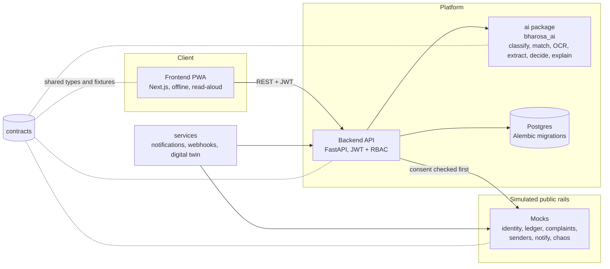

# Architecture

- **Frontend** (`/frontend`): mobile-first PWA for citizen, helper, officer, admin and auditor. Read-aloud, Urdu/English, progress saved to IndexedDB. In `fixtures` mode it runs with no backend.
- **Backend** (`/backend`): the single trusted entry point. Authenticates (JWT), authorises (server-side RBAC), manages cases, runs the claim pipeline (resumable steps), versions rules, manages consent, writes the audit log, issues API keys, and exposes Swagger.
- **AI package** (`/ai`): pure functions behind a typed interface. Every output has `confidence` and `model_version`. `AI_MODE=stub|real` swaps implementations without changing callers.
- **Mocks** (`/mocks`): simulated NADRA/Raast/complaints/SMS with deterministic seed data and in-memory chaos switches (timeout, 500, missing record, duplicate payment, lookalike sender, slow network). Everything returns `simulated: true`.
- **Postgres**: cases, claims, decisions, rules and versions, consent, audit log, API keys. Alembic migrations.
- **Services** (`/services`): notifications, webhooks and the Digital Twin simulation. They use the public API.
- **Contracts** (`/contracts`): enums, Pydantic schemas, AI interface, OpenAPI lists and fixtures that let four people build in parallel.
- **Claim pipeline**: consent check -> extract claim -> read document -> identity match -> ledger lookup -> decide -> explain -> persist and audit. If a mock fails, the case goes to `with_officer` with notes.
